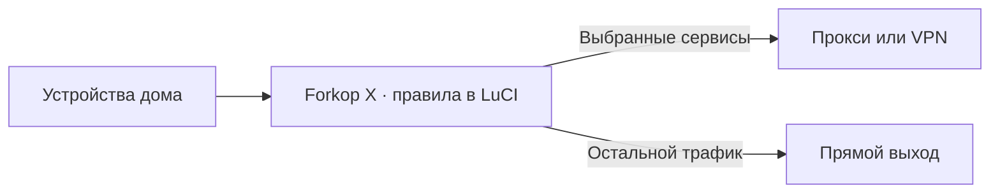

# Forkop X

[](https://github.com/slayer326/forkop/releases/latest)
[](#совместимость)
[](LICENSE)

Forkop X управляет маршрутизацией домашней сети из LuCI. Выберите, какие сайты, сервисы или устройства пойдут через прокси или VPN, а какие сохранят прямой выход. Настройки применяются на роутере, поэтому приложения на телефонах, телевизорах и компьютерах используют те же правила.

[Установка](#установка) · [Возможности](#возможности) · [Совместимость](#совместимость) · [WARP](docs/warp.md) · [Обратная связь](https://github.com/slayer326/forkop/issues)



## Установка

Сначала найдите свою версию OpenWrt и платформу в [индексе зеркала](https://mirror.infotechtg.ru/openwrt/forkop-platforms.tsv). Узнать их на роутере можно командой `ubus call system board`.

Скачайте и запустите установщик по SSH от имени root.

```sh
wget -O /tmp/forkop-install.sh https://fold8.ru/forkop/install.sh &&
    sh /tmp/forkop-install.sh
```

Установщик проверит наличие репозиториев для вашей прошивки и предложит вариант ядра. После установки откройте **LuCI → Службы → Forkop**, добавьте подключение и создайте правило для нужного сервиса или устройства.

## Возможности

| Задача | Что есть в Forkop X |
| --- | --- |
| **Разделить трафик** | Правила по доменам, IP и устройствам. Готовые списки для Steam, Nintendo, Blizzard и других сервисов, собственные текстовые списки и наборы правил `.srs` / `.json`. Прозрачный перехват через nftables/TPROXY и FakeIP. |
| **Подключить прокси** | Share-ссылки VLESS, VMess, Trojan, Shadowsocks, SOCKS и Hysteria2. Конфигурации JSON и HTTPS-подписки с обновлением по расписанию. |
| **Выбрать рабочий узел** | URLTest измеряет задержку, Priority задаёт порядок переключения. Узлы подписки можно фильтровать и объединять в группы. |
| **Подключить WARP** | Мастер импортирует или генерирует профиль, подготавливает WireGuard / AmneziaWG и создаёт отдельный интерфейс OpenWrt. Можно проверить время последнего рукопожатия. [Как настроить WARP](docs/warp.md) |
| **Настроить DNS** | Готовые провайдеры и свой сервер, DoH, DoT и DoQ в зависимости от ядра, отдельные настройки по секциям и резервный DNS. |
| **Разобраться в сбое** | Диагностика DNS, FakeIP, nftables и sing-box. Проверка сайта, журнал, мониторинг соединений, история применения и отчёт для поддержки. |

> Потоковое видео можно направить через подписку с URLTest, игровую приставку оставить на прямом маршруте, а для отдельного сервиса выбрать WARP. Каждое правило настраивается в своей секции LuCI.

### Ядро и обновления

- **sing-box Tiny и Stable** доступны через пакеты OpenWrt. **Extended** и **podkop-engine** доступны для архитектур, под которые выпущены соответствующие сборки. Для современных серверов Xray в podkop-engine доступны XHTTP и шифрование VLESS. [podkop-engine](https://github.com/podkop-net/podkop-engine)
- **Списки и подписки** обновляются по расписанию. Если источник списков недоступен, Forkop может использовать проверенную последнюю полную копию, когда она соответствует текущей конфигурации.
- **Обновление пакетов** начинается с проверки совместимости и подготовки к восстановлению. В LuCI можно проверить обновление, выбрать опубликованную версию и посмотреть результат операции.

## Совместимость

| Платформа | Архитектура | Установка из зеркала |
| --- | --- | --- |
| MediaTek Filogic | `aarch64_cortex-a53` | OpenWrt 24.10 и 25.12, по индексу |
| Rockchip ARMv8 | `aarch64_generic` | OpenWrt 24.10 и 25.12, по индексу |
| MediaTek MT7621 | `mipsel_24kc` | OpenWrt 25.12.5 |
| x86-64, в том числе VM | `x86_64` | OpenWrt 25.12.6 после публикации строки `x86/64` в индексе |

OpenWrt 24.10 использует IPK/`opkg`, OpenWrt 25.12 — APK/`apk`. Для WireGuard и AmneziaWG нужны системные пакеты, совместимые с ядром вашей прошивки. Установка с зеркала доступна для сочетаний из [актуального индекса](https://mirror.infotechtg.ru/openwrt/forkop-platforms.tsv).

Файлы Forkop публикуются в [релизах GitHub](https://github.com/slayer326/forkop/releases) и [канале обновлений](https://fold8.ru/forkop/updates/latest.json). Зависимости OpenWrt и списки обслуживает [зеркало Forkop](ops/mirror/README.md).

## Обратная связь

Пишите о проблемах и предложениях в [Issues](https://github.com/slayer326/forkop/issues). Укажите модель или гипервизор, версию OpenWrt и Forkop, действие и текст ошибки. В LuCI отчёт доступен в **Диагностика → Скачать отчёт для поддержки**. Перед публикацией удалите приватные адреса, ссылки на подписки и ключи.

## Благодарности

Forkop X продолжает работу [Podkop](https://github.com/itdoginfo/podkop), [Forkop / Podkop Plus](https://github.com/ushan0v/forkop) и [Forkop X](https://github.com/Screamshow/forkop-x). Спасибо авторам [sing-box](https://github.com/SagerNet/sing-box), [sing-box Extended](https://github.com/shtorm-7/sing-box-extended), [podkop-engine](https://github.com/podkop-net/podkop-engine), [OpenWrt](https://github.com/openwrt/openwrt), [LuCI](https://github.com/openwrt/luci) и [ucode](https://github.com/ucode-lang/ucode).

Списки и правила поддерживают проекты [allow-domains](https://github.com/itdoginfo/allow-domains), [b4geoip-forkop](https://github.com/Greeg0ry/b4geoip-forkop), [meta-rules-dat](https://github.com/MetaCubeX/meta-rules-dat), [ad-filter](https://github.com/zxc-rv/ad-filter) и [sing-box-supercell-ruleset](https://github.com/ushan0v/sing-box-supercell-ruleset).

[Лицензия GPL-2.0-or-later](LICENSE).
